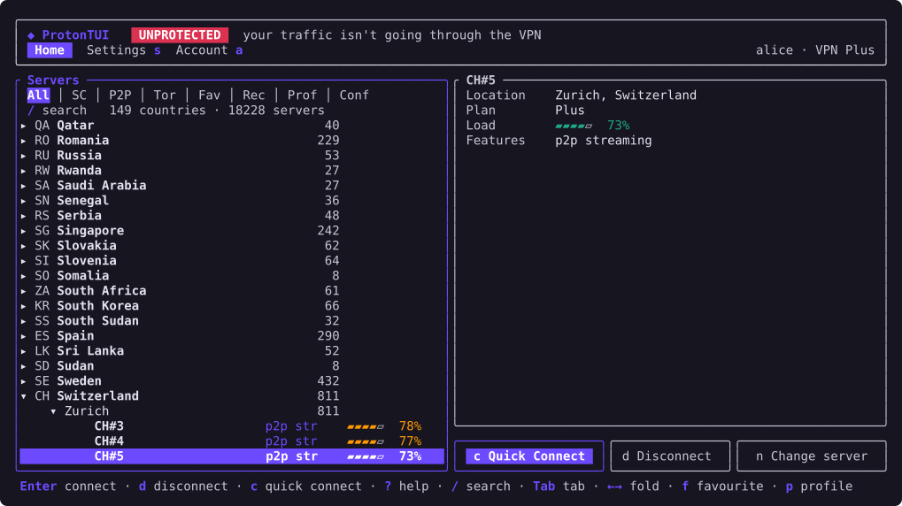
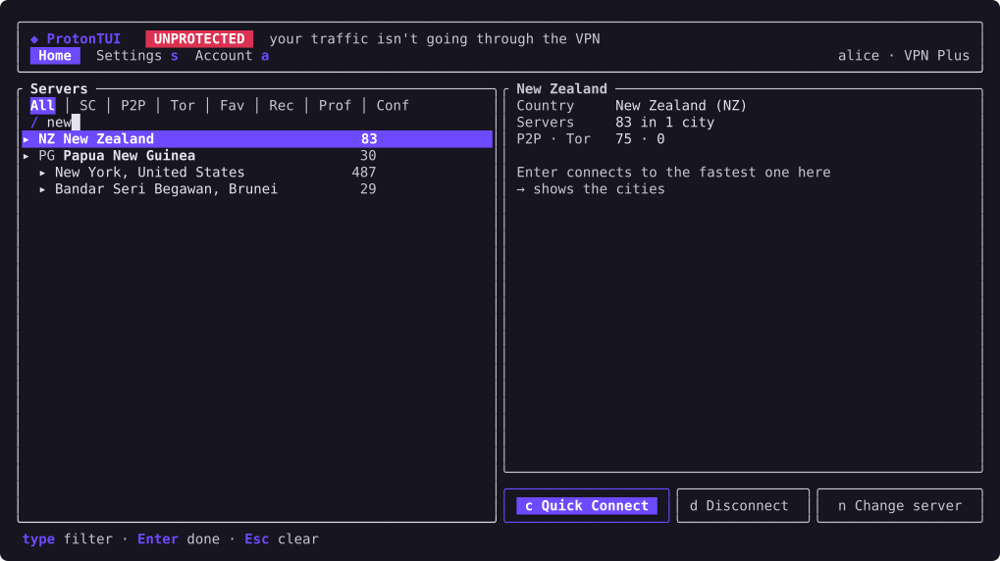
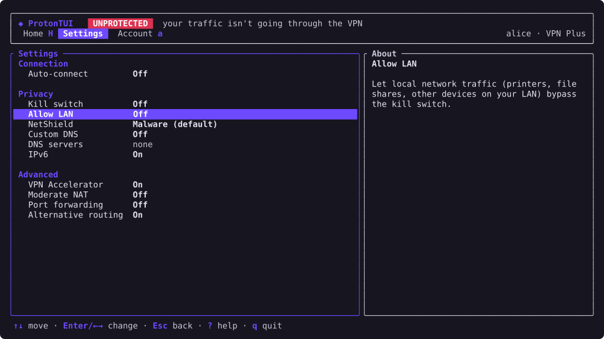

# protontui

A terminal client for Proton VPN. It signs in, browses every server the account can use, and connects the
**whole host** through WireGuard, with a kill switch, NetShield, port forwarding and the other features of the
official apps. It's one static binary with two roles: `protontui daemon` runs as root and owns the network;
`protontui` (the TUI and the CLI subcommands) runs as your user and talks to the daemon over
`/run/protontui.sock`. It runs on any Linux distribution, Alpine (musl, OpenRC) first.



<details>
<summary>More screens: search, settings</summary>




</details>

Status: usable day to day; see `TESTING.md` for what has been checked and how.

## Install

### Release binaries

Every push builds static binaries for `x86_64` and `aarch64` (GitHub Actions, "CI" workflow, artifacts
`protontui-x86_64-unknown-linux-musl` and `protontui-aarch64-unknown-linux-musl`). They're built **without
the local agent** (see [License](#license)): NetShield, VPN Accelerator and Moderate NAT still apply, as part
of the VPN certificate, but there's no port forwarding, no NetShield statistics and no live feature changes
while connected. Build from source for those.

```sh
doas install -m 0755 protontui /usr/local/bin/protontui
```

### Alpine package

`packaging/alpine/APKBUILD` builds a package (dynamically linked against the system musl, as Alpine packages
are) with the OpenRC service, and creates the `protontui` group. It downloads the tagged release, so once
`v0.1.0` exists on GitHub:

```sh
cd packaging/alpine && abuild checksum && abuild -r
```

### From source

Needs Rust 1.88 or newer (rustup), `cmake` and a C compiler (for `aws-lc-rs`). Proton's `local_agent_rs`
crate is expected next to this repository, at `../python-proton-vpn-local-agent/local_agent_rs`; if you don't
have that checkout, fetch it (the GitHub archive of the pinned commit):

```sh
sh scripts/fetch-local-agent.sh
cargo build --release                       # static x86_64 binary (see .cargo/config.toml)
doas install -m 0755 target/x86_64-unknown-linux-musl/release/protontui /usr/local/bin/protontui
```

For ARM, cross-compile with [cargo-zigbuild](https://github.com/rust-cross/cargo-zigbuild) (needs `zig`):

```sh
rustup target add aarch64-unknown-linux-musl
cargo zigbuild --release --target aarch64-unknown-linux-musl
```

`--no-default-features` leaves the local agent out (what the release binaries do).

### The daemon

Members of the group `protontui` may use the daemon:

```sh
doas addgroup -S protontui          # systemd distros: sudo groupadd --system protontui
doas addgroup "$USER" protontui     # systemd distros: sudo usermod -aG protontui "$USER"
```

Log out and back in for the group to apply.

**OpenRC (Alpine).** The service runs under `supervise-daemon`, which starts the daemon again if it ever dies,
and it starts before the network, so that a permanent kill switch blocks from the first packet on. When
upgrading from an older copy of the script, stop the service with the old one first.

```sh
doas rc-service protontui stop 2>/dev/null
doas install -m 0755 packaging/openrc/protontui /etc/init.d/protontui
doas rc-update add protontui default
doas rc-service protontui start
```

**systemd.**

```sh
sudo install -m 0644 packaging/systemd/protontui.service /etc/systemd/system/protontui.service
sudo systemctl enable --now protontui
```

The kill switch needs `nftables` (`apk add nftables`). The daemon logs to `/var/log/protontui.log` and keeps its
state (session, keys, certificate, settings) in `/var/lib/protontui`, readable by root only.

## Use

Run `protontui` with no arguments for the TUI: sign in, browse servers by country, city, Secure Core, P2P or
Tor (`/` searches), Enter connects, `d` disconnects, `c` is Quick Connect, `f` adds a favourite, `p` saves the
selection as a profile, `s` and `a` open Settings and Account, `?` lists every key. Quitting the TUI leaves the
connection up.

The CLI does the same from scripts:

```sh
protontui login                       # username, password, 2FA code
protontui connect --country CH        # or --server CH#10, or --feature p2p; returns once connected
protontui status
protontui config kill-switch standard # off | standard | permanent; `protontui config` lists every setting
protontui disconnect
protontui logout
```

### Profiles

A profile is a named connection: where to (fastest, a country, a city, a server, Secure Core), optionally a
server feature (P2P, Tor, streaming), a WireGuard port, and NetShield, VPN Accelerator, Moderate NAT and port
forwarding values that override the global settings while it's connected.

```sh
protontui profile add torrents --country CH --feature p2p --port-forwarding on --netshield 2
protontui profile add sc --secure-core --country JP --entry SE
protontui profile set torrents --port 443          # `default` puts an option back to the global setting
protontui profile list
protontui connect --profile torrents
protontui config auto-connect profile:torrents     # at boot; or fastest, last, off
```

In the TUI, `p` saves the selected country, city or server (with the tab's feature) as a profile; the Profiles
tab connects (Enter) and deletes (`x`) them, and the Settings screen offers them for auto-connect.

### Without an account

Proton's "continue as guest" only works for its mobile apps, but a WireGuard config downloaded from
account.proton.me (VPN → WireGuard configuration) connects without signing in, through the same tunnel, routing,
DNS and kill switch:

```sh
protontui import ~/Downloads/wg-CH-45.conf   # or `i` in the TUI; stored 0600 in /var/lib/protontui/profiles
protontui connect --config wg-CH-45
protontui configs                            # list; `protontui remove-config NAME` deletes one
```

Such a connection has no API session, so the features (NetShield, Moderate NAT, …) are the ones chosen when
the file was made, and there's no port forwarding or live feature change. Only full-tunnel configs
(`AllowedIPs = 0.0.0.0/0`) are accepted; `PostUp`-style scripts are never run.

### When the API is blocked

If `vpn-api.proton.me` can't be reached from the network you're on, protontui finds Proton's alternative
routes the way the official apps do: TXT records looked up over DNS over HTTPS (Quad9, Google), then TLS to
those hosts pinned to Proton's keys. It's on by default (`protontui config alternative-routing off` turns it
off), applies only while disconnected, and can't get through a permanent kill switch.

### When something goes wrong

The connection stays up when the CLI or TUI exits, and comes back by itself after a network change or a
suspend. If the daemon dies, the service manager restarts it; a standard kill switch keeps blocking until you
connect or disconnect. If the network is ever left in a bad state (tunnel, routes, DNS or firewall),
`doas protontui recover` removes everything protontui changed, including a permanent kill switch.

For development, `--standalone` runs the engine in the CLI or TUI process itself (as root) instead of the
daemon; quitting the standalone TUI disconnects. The TUI logs to `~/.local/state/protontui/protontui.log`.

## License

protontui is GPL-3.0-or-later (it ports logic from Proton's GPL clients). It uses Proton's
[`proton-srp`](https://github.com/ProtonMail/proton-crypto-rs) (MIT) and, by default, Proton's
[`local_agent_rs`](https://github.com/ProtonVPN/local-agent-rs), which is published **without a license**.
Building it for yourself is fine; binaries meant for others are built with `--no-default-features`, which
leaves it out (this repository doesn't contain it either: `scripts/fetch-local-agent.sh` downloads it from
Proton).
